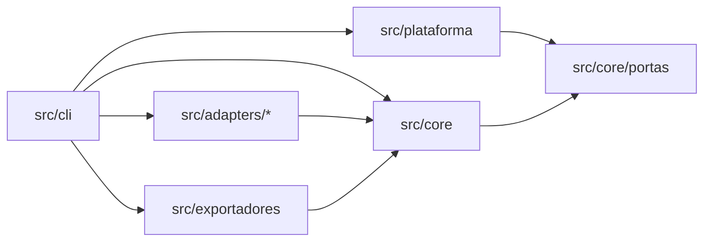

# Mapa de módulos

> Status: Estável · Atualizado: 2026-10-24 · Relacionados: [ADR-0010](../adr/0010-pacote-unico-com-fronteiras-internas.md), [ADR-0015](../adr/0015-nucleo-sem-io-com-portas-e-adapters-puros.md), [ADR-0001](../adr/0001-alvos-iniciais-claude-code-e-copilot.md), [ADR-0004](../adr/0004-observabilidade-langfuse-opcional.md), [roadmap](../roadmap.md)

## Objetivo
Dizer onde cada responsabilidade do harness mora no código (`src/`), quem pode importar quem e em que fase cada módulo nasce. Responde "responsabilidades do núcleo vs. adapters" do [contexto §12](../contexto.md#12-perguntas-em-aberto).

## Escopo
Inclui camadas, módulos do núcleo, regras de dependência e o fluxo de `add`/`apply`. Não inclui os contratos (schemas da F1), o contrato de adapter (F3) nem a matriz de capacidades.

## Especificação

### Camadas



| Camada | Pasta | Responsabilidade | Não faz | Nasce |
|---|---|---|---|---|
| Núcleo | `src/core/` | Modelo neutro dos componentes, regras e decisões | I/O direto; formato de um ambiente | F0 |
| Portas | `src/core/portas/` | Interfaces de arquivos (com raiz), Git, relógio, identidade, eventos | Implementação | F1 (interfaces), F2 (uso) |
| Plataforma | `src/plataforma/` | Implementa as portas com Node; porta de arquivos é a única via de escrita | Regra de negócio | F1 (vazia), F2 |
| Adapters de ambiente | `src/adapters/claude-code/`, `src/adapters/copilot/` | Modelo neutro → arquivos em memória + capacidades suportadas | Gravar; importar outro adapter | F0 (vazios), F3 |
| Exportadores | `src/exportadores/` | Eventos → OpenTelemetry → Langfuse, opt-in | Ser chamado pelo núcleo | F5 |
| CLI | `src/cli/` | Comandos, argumentos, saída; liga as camadas | Regra de negócio | F0, F2 |

### Módulos do núcleo
Pastas criadas só quando o primeiro código existir ([contexto §7.7](../contexto.md#77-evolução-incremental)).

| Módulo | Responsabilidade | Contrato (F1) | Nasce |
|---|---|---|---|
| `modelo` | Tipos neutros: pacote, componente (agent, skill, instruction, MCP, policy, validator, workflow) | Manifesto | F2 |
| `contratos` | Leitura segura de JSON, validação por JSON Schema ([ADR-0019](../adr/0019-validacao-de-contratos-com-cfworker-json-schema.md)) e formato de erro comuns a todos os contratos | Todos | F1 |
| `manifesto` | Validar manifesto, regras de caminho e comando, diff de permissões ([spec](../specs/manifesto-de-pacote.md)) | Manifesto | F1 (validação), F2 (leitura do pacote) |
| `config` | Configuração do projeto | Configuração | F2 |
| `resolucao` | Tag semver → commit SHA, pela porta Git | Lockfile | F2 |
| `lockfile` | Ler, gravar e verificar hash de conteúdo | Lockfile | F2 |
| `plano` | Diff entre o instalado e os arquivos em memória dos adapters; base de `plan` e `--dry-run` | — | F2 |
| `customizacoes` | Preservar e detectar conflito com edições locais | — | F2 |
| `validadores` | Verificações determinísticas sobre manifesto, plano e projeto (`validate`, `doctor`, `validate --ci`) | — | F2, F4 |
| `policies` | Combinar fontes por precedência e decidir com explicação | Policy | F4 |
| `evidencias` | Registro solicitado / executado / verificado / falhou / ignorado | Evidência | F4 |
| `auditoria` | Eventos JSONL com ator, versão e resultado; encadeamento de hash na F4 | Evento de auditoria | F2, F4 |
| `telemetria` | Modelo neutro de spans e redação de segredos antes de sair do núcleo | — | F5 |

### Regras de dependência

| Regra | Imposta por |
|---|---|
| `src/core` não importa `src/adapters` nem `src/cli` | Lint ([ADR-0010](../adr/0010-pacote-unico-com-fronteiras-internas.md)) |
| `src/core` e os adapters não importam módulos de I/O do Node: `fs`, `fs/promises`, `child_process`, `net`, `http`, `https`, `http2`, `tls`, `dgram`, `dns`, `dns/promises`, `worker_threads`, `cluster`, `vm`, `module`, `inspector`, `inspector/promises`, `wasi`, `repl`, `readline`, `readline/promises`, `process`, `v8`, `trace_events` (com ou sem o prefixo `node:`) e `node:sqlite` (vale para `import`, `import()`, `require` e `export * from`) | Lint ([ADR-0015](../adr/0015-nucleo-sem-io-com-portas-e-adapters-puros.md)) |
| `src/core` e os adapters não usam os globais `process`, `globalThis`, `global`, `self`, `fetch`, `WebSocket`, `EventSource`, `XMLHttpRequest`, `Worker` e `Function` | Lint ([ADR-0015](../adr/0015-nucleo-sem-io-com-portas-e-adapters-puros.md)) |
| `src/core` não importa `src/plataforma` nem `src/exportadores` | Lint ([ADR-0015](../adr/0015-nucleo-sem-io-com-portas-e-adapters-puros.md)) |
| Adapter não importa outro adapter, `src/cli`, `src/plataforma` nem `src/exportadores`; cada pasta de `src/adapters/` tem override própria no `biome.json`, com as mesmas listas de I/O e globais; arquivo solto em `src/adapters/` não importa um adapter | Lint + teste ([ADR-0015](../adr/0015-nucleo-sem-io-com-portas-e-adapters-puros.md)) |
| Toda gravação em disco passa pela porta de arquivos | Lint barra imports e globais de I/O; import com nome calculado, reexport por pasta nova e dependência npm com I/O ficam para um teste de arquitetura na F2 |
| Só `src/cli` compõe as camadas | Convenção + revisão |

### Fluxo de `add`/`apply`

```mermaid
sequenceDiagram
  participant CLI as src/cli
  participant N as src/core
  participant G as porta Git
  participant A as adapter
  participant F as porta de arquivos
  CLI->>N: add pacote@versão
  N->>G: resolve tag → SHA, lê conteúdo
  N->>N: valida manifesto e permissões
  N->>A: modelo neutro
  A-->>N: arquivos em memória + capacidades
  N->>N: plano (diff) + policies
  N->>F: grava (só no apply; dry-run para aqui)
  N->>N: evidência + evento de auditoria
```

## Validação
- `npm run lint` com as regras do `biome.json`; casos permitidos e negados em `test/ferramental/fronteiras.test.ts`.
- `src/core/portas/index.ts` só com interfaces; `npm run typecheck` passa.

## Compatibilidade
Mudança de camada ou de regra de dependência exige ADR novo. Criar módulo do núcleo dentro desta tabela não exige.

## Em aberto
- Contrato de adapter e testes de conformidade — F3.
- Formato exato de "arquivo em memória" (caminho relativo, conteúdo, modo) — ficha do manifesto ou F2.
