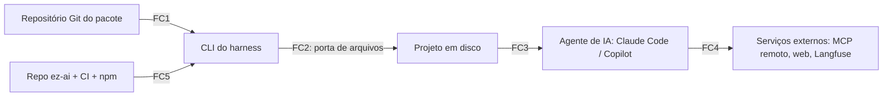

# Modelo de ameaças

> Status: Estável · Atualizado: 2026-10-24 · Relacionados: [ADR-0017](../adr/0017-propriedade-de-pacotes-por-identidade-github.md), [ADR-0018](../adr/0018-invariantes-de-seguranca-da-instalacao.md), [ADR-0016](../adr/0016-governanca-por-nivel-de-enforcement.md), [ADR-0015](../adr/0015-nucleo-sem-io-com-portas-e-adapters-puros.md), [ADR-0005](../adr/0005-distribuicao-git-lockfile.md), [matriz de capacidades](matriz-de-capacidades.md), [contexto §8](../contexto.md#8-segurança-e-confiança), [revisão de segurança](../guias/revisao-de-seguranca.md), [roadmap](../roadmap.md)

## Objetivo
Listar, pelo método STRIDE, as ameaças ao harness e a quem o instala, com severidade, controle e fase do roadmap. Cumpre o critério de saída da [F1](../roadmap.md#f1--contratos-e-modelo-de-ameaças-s3s5): toda ameaça `Alta` tem controle planejado em uma fase. É a fonte das ameaças usada pelo agente `seguranca` e pelo [checklist de revisão](../guias/revisao-de-seguranca.md).

## Escopo
Inclui pacotes (manifesto, arquivos, tags, scripts, hooks, MCP), a CLI e a porta de arquivos, os arquivos gerados e o agente de IA que os lê, telemetria e a cadeia de suprimentos do próprio harness. Não inclui as regras de posse de pacote ([ADR-0017](../adr/0017-propriedade-de-pacotes-por-identidade-github.md)), os campos do manifesto e das permissões ([spec do manifesto](../specs/manifesto-de-pacote.md)), o formato de policy, de evidência e de auditoria (fichas 5 a 7) nem a implementação dos controles (F2 a F8).

## Especificação

### Ativos
| Ativo | Por que importa |
|---|---|
| Código e arquivos do projeto que instala | É o que o agente de IA lê e altera |
| Segredos (`.env`, chaves de API, tokens, chave de IA do usuário) | Vazamento custa dinheiro e acesso |
| Máquina do desenvolvedor e runner de CI | Scripts de hook e MCP rodam com os privilégios do usuário |
| Arquivos de enforcement (`.claude/settings.json`, `.github/hooks/**`, `.mcp.json`, `.vscode/mcp.json`, CODEOWNERS, lockfile e a lista de origens permitidas na configuração do projeto) | Quem os edita desliga os controles ([ADR-0016](../adr/0016-governanca-por-nivel-de-enforcement.md)) |
| Lockfile, auditoria e evidências | Base para saber o que foi instalado e quem aprovou |
| Repositório `ez-ai`, CI e publicação no npm | Comprometidos, entregam código malicioso a todos os usuários |

### Fronteiras de confiança

| # | Fronteira | O que atravessa |
|---|---|---|
| FC1 | Repositório Git do pacote → CLI | Manifesto, arquivos, tags, refs |
| FC2 | CLI → disco do projeto, pela porta de arquivos ([ADR-0015](../adr/0015-nucleo-sem-io-com-portas-e-adapters-puros.md)) | Arquivos gerados pelos adapters |
| FC3 | Arquivos gerados → agente de IA em execução | Instruções, agentes, skills, hooks, MCP |
| FC4 | Projeto e agente → serviços externos | Prompts, respostas de ferramentas, traces |
| FC5 | Repositório `ez-ai`, CI e npm → quem instala o harness | O próprio harness e suas dependências |

### Severidade
| Nível | Regra |
|---|---|
| `Alta` | Permite executar código, vazar segredo ou desligar/burlar um controle, e é explorável por quem publica um pacote ou escreve conteúdo que o agente lê, sem acesso prévio à máquina |
| `Média` | Impacto limitado (travar, perder rastreabilidade) ou exige acesso prévio ao projeto ou à máquina |
| `Baixa` | Incômodo, sem perda de dados nem de controle |

Tipo de controle: `harness` (código determinístico do próprio harness), `ambiente` (mecanismo do Claude Code ou do Copilot, classificado pelo [ADR-0016](../adr/0016-governanca-por-nivel-de-enforcement.md)), `servidor` (CI obrigatório, ruleset, CODEOWNERS), `humano` (revisão ou aprovação explícita). Controle só por instrução ao modelo não conta.

### Ameaças

| Id | STRIDE | Fronteira | Ameaça | Sev. | Controle | Tipo | Fase | Teste previsto |
|---|---|---|---|---|---|---|---|---|
| S1 | Spoofing | FC1 | Pacote se passa por outro dono: nome parecido (typosquatting), repositório renomeado ou apagado e retomado, conta comprometida | Alta | Origens permitidas até a F7 ([ADR-0018](../adr/0018-invariantes-de-seguranca-da-instalacao.md)); nome `<login>/<pacote>`, dono assinado e gravado no lockfile, troca de dono bloqueada ([ADR-0017](../adr/0017-propriedade-de-pacotes-por-identidade-github.md)); no manifesto, nome só ASCII minúsculo e repositório/assinatura do mesmo dono ([spec do manifesto](../specs/manifesto-de-pacote.md)); origens permitidas por repositório exato e login da origem igual ao do pacote; troca entre GitHub e `local:` conta como troca de dono ([spec da configuração e do lockfile](../specs/configuracao-e-lockfile.md)) | harness | F1, F2, F7 | `add` de origem fora da lista é recusado; `update` assinado por outra conta é recusado |
| S2 | Spoofing/Tampering | FC1 | Tag semver reapontada para um commit malicioso | Alta | Lockfile fixa SHA + hash de conteúdo ([ADR-0005](../adr/0005-distribuicao-git-lockfile.md)); `update` mostra o diff e pede confirmação; tag presa à versão e hash da árvore inteira do pacote ([spec da configuração e do lockfile](../specs/configuracao-e-lockfile.md)) | harness, humano | F1, F2 | Tag movida com lockfile existente falha a verificação |
| T1 | Tampering | FC2 | Path traversal (`..`), caminho absoluto, symlink ou junction para fora, nome reservado do Windows (`CON`, `NUL`), colisão de maiúsculas/minúsculas | Alta | Porta de arquivos única ([ADR-0015](../adr/0015-nucleo-sem-io-com-portas-e-adapters-puros.md)) normaliza e rejeita; fuzzing de manifestos; no manifesto, regras de caminho em `arquivo`, globs e nome do pacote ([spec do manifesto](../specs/manifesto-de-pacote.md)); pasta `local:` dentro do projeto, fora de pastas ocultas; caminhos do hash só ASCII e sem colisão de caixa ([spec da configuração e do lockfile](../specs/configuracao-e-lockfile.md)) | harness | F1, F2 | Casos negados nos 3 SOs; fuzzing sem escrita fora da raiz |
| T2 | Tampering/Elevation | FC2 | Pacote grava em arquivo de enforcement, do núcleo, do projeto ou de outro pacote, ou em arquivo que vira execução ou instrução quando outra ferramenta roda (scripts do npm, hooks do Git, `CLAUDE.md` aninhado) | Alta | Destinos permitidos por tipo de componente; pasta isolada por pacote ([ADR-0017](../adr/0017-propriedade-de-pacotes-por-identidade-github.md)); arquivo de enforcement só via componente declarado e aprovado; no manifesto, `escrever` não alcança destino protegido, destino executável é marcado e `hook`/`mcp` declaram `configurarAmbiente` ([spec do manifesto](../specs/manifesto-de-pacote.md)) | harness | F1, F2, F4 | Pacote que mira `.claude/settings.json` sem declarar é recusado no `plan` |
| T3 | Tampering | FC1 | Injeção de argumento ou transporte no Git: ref ou URL começando com `-` (ex.: `--upload-pack=`), transporte `ext::` ou `file://` não pedido, submódulos | Alta | Argumentos em array, separador `--`, validação de ref e de esquema da URL (só `https` e caminho local explícito), `protocol.ext.allow=never`, sem submódulos, nunca `shell` | harness | F2 | Refs, URLs e transportes maliciosos rejeitados antes de chamar o Git; submódulo não é baixado |
| T4 | Tampering | FC3 | Agente ou pessoa edita arquivo de pacote instalado ou arquivo de enforcement, inclusive alterando arquivo e hash do lockfile juntos, ou incluindo a própria origem na lista permitida | Alta | `validate --ci` busca de novo o SHA na origem e recalcula o hash (não confia só no lockfile); CODEOWNERS + ruleset nos arquivos de enforcement, lockfile e lista de origens ([ADR-0016](../adr/0016-governanca-por-nivel-de-enforcement.md)); F2 recalcula hash e retrato de permissões a partir do commit travado e falha se o lockfile divergir ([spec da configuração e do lockfile](../specs/configuracao-e-lockfile.md)) | harness, servidor | F2, F4 | Arquivo de pacote e hash alterados juntos fazem o job de CI falhar; mudança na lista de origens exige code owner |
| T5 | Tampering | FC3 | Texto invisível ou enganoso na instrução do pacote (caracteres bidi, de largura zero, tags Unicode, sequências ANSI de terminal): o diff do `plan` mostra algo diferente do que o agente lê | Alta | `plan` escapa ou rejeita caracteres de controle e invisíveis em todo texto de instrução; o manifesto recusa caracteres invisíveis em todo texto ([spec do manifesto](../specs/manifesto-de-pacote.md)); configuração e lockfile recusam invisíveis em todo texto ([spec da configuração e do lockfile](../specs/configuracao-e-lockfile.md)) | harness | F1, F2 | Fixture com tag Unicode e ANSI aparece escapada no `plan` |
| R1 | Repudiation | FC2 | Operação sem registro, log de auditoria editado, aprovação sem autor | Média | Evento de auditoria JSONL em toda operação (F2); encadeamento de hash e aprovador identificado (F4) | harness | F2, F4 | `doctor` detecta log adulterado |
| I1 | Information disclosure | FC4 | Segredo aparece em log, auditoria, evento, trace ou lockfile (ex.: token embutido na URL `https://token@...`) | Alta | Redação no núcleo antes de sair; URL com credencial é recusada; telemetria desligada por padrão ([ADR-0004](../adr/0004-observabilidade-langfuse-opcional.md)); o manifesto recusa `repositorio` com credencial ([spec do manifesto](../specs/manifesto-de-pacote.md)); configuração e lockfile recusam origem com credencial, o lockfile não guarda segredo e o hash recusa arquivo de segredo no pacote ([spec da configuração e do lockfile](../specs/configuracao-e-lockfile.md)) | harness | F1, F2, F5 | Segredos de fixture nunca chegam à auditoria, ao lockfile nem ao exportador |
| I2 | Information disclosure | FC3, FC4 | Instrução de pacote leva o agente a ler `.env` ou chaves e enviar para fora (MCP, web, Bash) | Alta | Permissões mínimas declaradas e aprovadas; `deny` de leitura de segredos (Claude `nativo`; Copilot `parcial` → secret scanning e aviso); MCP de pacote exige aprovação; no manifesto, `ler` sensível é marcado e `segredos` só por nome ([spec do manifesto](../specs/manifesto-de-pacote.md)) | ambiente, servidor, humano | F1, F4, F7 | Golden file do adapter Claude contém o `deny`; `apply` no Copilot emite o aviso; `plan` lista MCP novo para aprovação |
| D1 | Denial of service | FC1 | Pacote enorme, muitos arquivos, árvore profunda ou manifesto que trava o parser | Média | Limites de tamanho, quantidade, profundidade e tempo ([spec do manifesto](../specs/manifesto-de-pacote.md#limites): manifesto validado na F1, pacote contado na F2); configuração ≤ 64 KiB, lockfile ≤ 8 MiB, 100 pacotes; limites só reduzíveis ([spec da configuração e do lockfile](../specs/configuracao-e-lockfile.md)) | harness | F1, F2 | Fuzzing e fixtures acima do limite falham com mensagem clara |
| D2 | Denial of service/Elevation | FC3 | Hook que falha aberto (timeout ou erro, que um pacote pode provocar, libera a ação) | Alta | Hook gerado fail-closed com teste de conformidade ([ADR-0016](../adr/0016-governanca-por-nivel-de-enforcement.md), condição 2) | harness, ambiente | F3, F4 | Conformidade: hook com dependência ausente bloqueia |
| E1 | Elevation | FC1, FC2 | Código do pacote roda durante a instalação (como o `postinstall` do npm) | Alta | O harness nunca executa código de pacote em `add`/`apply`/`update` ([ADR-0018](../adr/0018-invariantes-de-seguranca-da-instalacao.md)) | harness | F2 | Pacote de fixture com script não executa nada (sentinela não é criada) |
| E2 | Elevation | FC3 | Hooks, skills ou MCP do pacote rodam scripts com os privilégios do usuário | Alta | Origens permitidas até a F7 ([ADR-0018](../adr/0018-invariantes-de-seguranca-da-instalacao.md)); permissões declaradas e aprovadas; aumento de permissão entre versões exige nova aprovação ([ADR-0017](../adr/0017-propriedade-de-pacotes-por-identidade-github.md)); scripts de pacote de comunidade desligados por padrão (F7); `diferencaDePermissoes` acusa o aumento ([spec do manifesto](../specs/manifesto-de-pacote.md)); retrato das permissões aprovadas no lockfile, base do diff do `update` ([spec da configuração e do lockfile](../specs/configuracao-e-lockfile.md)) | harness, humano | F1, F2, F4, F7 | `update` com permissão nova para no `plan` sem aprovação; pacote de comunidade instalado com scripts desligados (F7) |
| E3 | Elevation | FC3 | Prompt injection em instrução, agente ou skill do pacote | Alta | Contenção ([ADR-0018](../adr/0018-invariantes-de-seguranca-da-instalacao.md)): privilégio mínimo, regras críticas fora do modelo, diff das instruções no `plan`/`update` para revisão humana. Bloqueio real vem do `servidor` e do `ambiente` onde `nativo`; o humano apoia | harness, ambiente, servidor, humano | F2, F4 | `plan` de `update` mostra o diff de todo texto de instrução; testes de conformidade das regras críticas (F4) |
| E4 | Elevation | FC4 | Prompt injection indireta (issue, página, resposta de MCP) leva o agente a desligar controles, dar push ou aprovar | Alta | Controles de E3 + CODEOWNERS/ruleset ([ADR-0016](../adr/0016-governanca-por-nivel-de-enforcement.md)); merge só humano ([ADR-0013](../adr/0013-fluxo-de-branches-develop-para-main.md)) | servidor, humano | F4 | Ruleset bloqueia merge de mudança em arquivo de enforcement sem code owner |
| E5 | Elevation | FC2 | Policy de pacote afrouxa uma regra do núcleo ou do projeto | Alta | Pacote só restringe, nunca afrouxa (precedência núcleo > organização > projeto > pacote; ficha de policy da F1) | harness | F4 | Policy de pacote que libera o que o projeto nega é ignorada e gera aviso |
| E6 | Elevation | FC5 | Cadeia de suprimentos do harness: dependência npm maliciosa, action comprometida, token de publicação roubado | Alta | Já existe: Dependabot com cooldown, actions por SHA, `ignore-scripts`, `min-release-age`, `npm audit signatures` ([contexto §14](../contexto.md#14-decisões-registradas)). Novo: SBOM e provenance (F7); publicação por OIDC sem token guardado (F8) | servidor | F0, F7, F8 | Já: jobs de CI de idade de dependência e `npm audit signatures`. Novo: release só publica com provenance verificável |
| E7 | Elevation | FC3, FC4 | MCP ou hook de pacote baixa código em tempo de execução (`npx algo@latest`, `curl ... \| sh`), fora da origem permitida e do lockfile | Alta | `plan` exige comando de MCP fixado por versão exata ou hash e recusa `@latest` e download seguido de execução em hook; regras de comando do manifesto ([spec do manifesto](../specs/manifesto-de-pacote.md)) | harness | F1, F2, F4 | Manifesto com `@latest` ou `curl \| sh` é recusado na validação |

### Riscos residuais aceitos
- Um agente pode obedecer a uma instrução maliciosa **dentro** do que as permissões permitem (E3, E4). Os controles limitam o estrago, não o zeram.
- No Copilot, enquanto hooks e permissões forem `parcial` ([matriz](matriz-de-capacidades.md#lacunas-de-enforcement-no-copilot)), I2 e E2 dependem de validador do lado do servidor, que só age no merge, não na máquina.
- Controles na máquina do desenvolvedor (pre-commit) podem ser pulados; contam só como aviso.
- Entre a F2 e a F4, T4, E4, E5 e I2 ainda não têm controle de servidor. Nesse intervalo a proteção vem das invariantes do [ADR-0018](../adr/0018-invariantes-de-seguranca-da-instalacao.md) (só origens permitidas, nenhum código na instalação) e do merge só humano ([ADR-0013](../adr/0013-fluxo-de-branches-develop-para-main.md)); harness nessa fase é para uso interno e beta, não para pacotes de terceiros.

## Validação
- `node .claude/skills/validar-docs/validar.mjs` confere links, índice e status.
- Cada fase que implementa um controle cita o id da ameaça na ficha e entrega o teste previsto; o `seguranca` confere a tabela no E4 de mudanças sensíveis ([time de agentes](../guias/time-de-agentes.md#2-fluxo-com-gates)).

## Compatibilidade
Documento vivo: revisado no início de cada fase e quando uma mudança sensível cria ameaça nova. Mudar severidade ou tirar controle de ameaça `Alta` exige justificativa no PR; mudar uma invariante do [ADR-0018](../adr/0018-invariantes-de-seguranca-da-instalacao.md) exige ADR novo.

## Em aberto
- Lista exata de destinos permitidos por tipo de componente (T2): contrato de adapter na F3.
