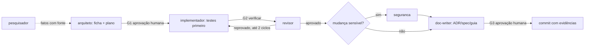

# Time de agentes

> Status: Rascunho · Atualizado: 2026-10-14 · Relacionados: [ADR-0009](../adr/0009-time-de-agentes-para-executar-o-roadmap.md), [roadmap](../roadmap.md), [ADR-0006](../adr/0006-workflow-mvp-feature-com-gates.md), [padrão de agentes e skills](padrao-de-agentes-e-skills.md)
>
> Fonte única de como o time de agentes executa os itens do roadmap. Os arquivos dos agentes apontam para cá e não repetem estas regras.

## Quando usar
Ao executar qualquer entrega do [roadmap](../roadmap.md) com apoio de agentes, em Claude Code ou GitHub Copilot.

## Pré-requisitos
- Item do roadmap identificado (fase e entrega).
- Agentes e skills do [inventário](padrao-de-agentes-e-skills.md#7-inventário) presentes no repositório.

## 1. Papéis

| Agente | Responsabilidade | Escreve em | Ferramentas |
|---|---|---|---|
| `arquiteto` | Transforma o item em ficha (critérios de aceite verificáveis) e plano; compara alternativas quando há decisão | Só `.tmp/tarefas/` (limite por instrução até a F4) | Leitura, edição, terminal para as skills |
| `pesquisador` | Responde perguntas sobre ferramentas externas (Claude Code, Copilot, Langfuse, Sigstore, npm) com fontes e data | Só `.tmp/pesquisa/` (limite por instrução até a F4) | Leitura, edição, web |
| `implementador` | Implementa o plano com testes primeiro, até as verificações passarem | Código, testes, config | Leitura, edição, terminal |
| `revisor` | Avaliador independente: confere o resultado contra a ficha e as regras, com evidência executada | Nada (só relatório) | Leitura + skills `escopo-da-mudanca` e `verificar` |
| `seguranca` | Revisão de ameaças e controles em mudanças sensíveis; apoia o modelo de ameaças (F1) e a supply chain (F7) | Nada (só relatório) | Leitura + skill `escopo-da-mudanca` |
| `doc-writer` | Registra ADRs, specs, guias e runbooks a partir do que os outros produziram | `docs/` | Ver [padrão de documentação](padrao-de-documentacao.md) |

A sessão principal (você + o assistente do ambiente) é o **orquestrador**: escolhe o agente de cada etapa, passa a ficha adiante e decide nos pontos de aprovação. Subagentes não chamam outros subagentes.

## 2. Fluxo com gates

O time usa o mesmo workflow que o produto vai entregar ([ADR-0006](../adr/0006-workflow-mvp-feature-com-gates.md)); cada execução é também um teste do MVP.



| Gate | Passa quando | Quem confere |
|---|---|---|
| G1 Plano | Ficha com critérios de aceite verificáveis, fora de escopo, testes previstos e riscos; perguntas `Em aberto` respondidas pelo usuário | Usuário |
| G2 Verificação | Skill `verificar` sem `falhou`; cada `ignorado` justificado | `revisor` (executa de novo, não confia no relato) |
| G3 Entrega | Relatório do `revisor` aprovado, do `seguranca` quando aplicável, docs validados | Usuário |

**Mudança sensível:** toca validação de caminhos, execução de comandos/scripts, permissões, policies, assinatura/integridade, telemetria/redação, CI ou dependências.

**Limite de iterações:** no máximo 2 ciclos `revisor → implementador` por ficha. Após a 2ª reprovação, o orquestrador para e leva o impasse ao usuário (o problema costuma estar no plano, não no código).

## 3. Escolha por fase

| Fase | Agentes principais | Observação |
|---|---|---|
| F0 Fundação | `implementador`, `revisor`, `seguranca` | Baseline de CI e supply chain passa por `seguranca` |
| F1 Contratos | `arquiteto`, `pesquisador`, `seguranca`, `doc-writer` | Matriz de capacidades e STRIDE; schemas com exemplos válidos/inválidos via `implementador` |
| F2 Núcleo | `arquiteto`, `implementador`, `revisor`, `seguranca` | Caminhos, symlinks e lockfile são sempre sensíveis |
| F3 Adapters | `pesquisador`, `implementador`, `revisor` | Spike do Copilot começa no `pesquisador` |
| F4 Governança | `arquiteto`, `implementador`, `seguranca`, `revisor` | Testes de policy permitida/negada são critério de aceite |
| F5 Observabilidade | `implementador`, `seguranca`, `revisor` | Redação de segredos sempre sensível |
| F6 Workflow MVP | Todos | O time vira fixture do benchmark |
| F7 Supply chain | `seguranca`, `pesquisador`, `implementador`, `revisor` | |
| F8 Release | `doc-writer`, `revisor`, `seguranca` | Checklist de release com evidências |

## 4. Handoffs

O trabalho passa entre agentes por arquivos, não por memória de conversa:

- **Ficha da tarefa:** `.tmp/tarefas/<fase>-<slug>/ficha.md`, criada pela skill `ficha-de-tarefa`. Seções: item do roadmap (citado do roadmap), critérios de aceite, fora de escopo, plano, testes previstos, riscos, perguntas `Em aberto`, registro de gates.
- **Pesquisa:** `.tmp/pesquisa/<assunto>.md`, cada afirmação com URL e data de acesso, marcada `Fato` ou `Hipótese`.
- **Relatório de revisão:** resposta do `revisor`/`seguranca` no formato da [seção 5](#5-formato-dos-relatórios), anexado à ficha pelo orquestrador.

`.tmp/` não é versionado. O registro durável fica no commit (seção 6) e, para decisões, em ADR.

## 5. Formato dos relatórios

`revisor` e `seguranca` respondem sempre assim:

```
Veredito: APROVADO | REPROVADO | BLOQUEADO (falta informação)
Evidências: <saída resumida da skill verificar, estado por verificação>
Achados:
- [bloqueante|importante|sugestão] arquivo:linha — problema — critério ou regra violada — correção proposta
Critérios de aceite: <um por linha: atendido (evidência) | não atendido | não verificável>
```

Sem achado bloqueante e com todos os critérios atendidos por evidência, o veredito é `APROVADO`. Opinião sem evidência vira `sugestão`.

## 6. Definição de pronto e commit
- Critérios de aceite atendidos com evidência; G1–G3 registrados na ficha.
- Commit em Conventional Commits com o bloco de evidências da skill `verificar` no corpo (ver [padrão de código e testes](padrao-de-codigo-e-testes.md#4-commits)).
- Nada `ignorado` ou `falhou` aparece como aprovado ([contexto §7.9](../contexto.md#79-evidências-em-vez-de-alegações)).

## 7. Princípios do time
1. **Contexto isolado:** cada agente recebe a ficha e as linhas que precisa, não a conversa inteira.
2. **Menor privilégio:** só `implementador` e `doc-writer` editam o repositório; avaliadores não editam o que avaliam.
3. **Avaliador independente:** quem implementa não aprova. O `revisor` reexecuta as verificações.
4. **Determinístico antes de LLM:** o que um script confere (testes, lint, links, schemas) não é julgado por agente.
5. **Fato ≠ hipótese:** afirmações sobre ferramentas externas exigem fonte; sem fonte, `Hipótese`.
6. **Instrução não é fronteira:** regras críticas viram validador, hook ou CI; até lá, ficam `Em aberto` ([contexto §7.1](../contexto.md#71-governança-como-parte-da-arquitetura)).

## Verificação
Para cada item concluído existe: ficha com gates registrados, relatório `APROVADO` do `revisor` e commit com bloco de evidências.

## Problemas comuns
| Sintoma | Causa | Solução |
|---|---|---|
| Revisor e implementador em ciclo | Critério de aceite vago ou plano errado | Após a 2ª reprovação, voltar ao `arquiteto` |
| Agente afirma comportamento de ferramenta sem fonte | Pulou o `pesquisador` | Marcar `Hipótese` e pesquisar |
| `verificar` mostra tudo `ignorado` | Projeto ainda sem `package.json` (antes da F0) | Esperado; registrar como `ignorado`, nunca como aprovado |
