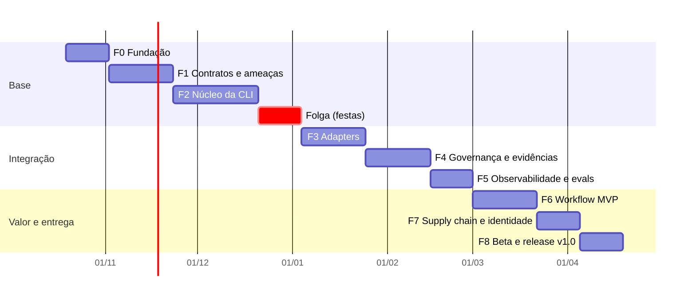

# Roadmap até a v1.0

> Status: Aceito (revisável a cada fase) · Atualizado: 2026-11-05 · Relacionados: [contexto](contexto.md), [ADRs](adr/README.md)

## Premissas

- **Capacidade:** 1 pessoa + agentes de IA. **Horizonte:** ~26 semanas (início 19/10/2026, v1.0 alvo em meados de abril/2027), com 2 semanas de folga no fim do ano.
- Decisões-base: [ADR-0001](adr/0001-alvos-iniciais-claude-code-e-copilot.md) a [ADR-0007](adr/0007-suporte-multiplataforma.md).
- Uma fase só termina quando **todos** os critérios de saída estão verificados por evidência (teste, CI, trace), não por declaração ([contexto §7.9](contexto.md#79-evidências-em-vez-de-alegações)).
- Escopo cortável está marcado com *(corte)*: é o primeiro a sair se houver atraso.

## Visão geral

| Marco | Fim de | Significado |
|---|---|---|
| **M1 — Contratos estáveis** | F1 | Schemas v0 e modelo de ameaças revisados |
| **M2 — Alpha interno** | F3 | CLI instala um pacote real nos dois ambientes |
| **M3 — MVP comprovado** | F6 | Workflow com gates rodando, com métricas no Langfuse |
| **M4 — v1.0 distribuída** | F8 | Publicado no npm com provenance, docs e garantias de compatibilidade |

**Situação em 2026-11-05** (Sprints 01 a 15 entregues; as pendências do Eduardo são testes manuais que fecham os marcos):

| Fase | Situação | Falta para fechar |
|---|---|---|
| F0 a F2 | Entregues | - |
| F3 Adapters | Código entregue (Sprint 04) | **M2:** spike do Copilot ([guia](arquitetura/spike-enforcement-copilot.md), ~30 min) e instalação real nos dois ambientes |
| F4 Governança | Entregue (Sprints 05 a 07) | Aplicar `docs/modelos/ruleset.json` em Settings > Rules; hooks/MCP do Copilot depois do spike |
| F5 Observabilidade | Entregue (Sprints 08 e 09) | Rodar o [runbook do Langfuse](guias/runbook-langfuse.md) uma vez |
| F6 Workflow MVP | Código entregue (Sprints 10 a 13) | **M3:** executar as 3 tarefas do benchmark nos dois ambientes |
| F7 Supply chain | Código entregue (Sprints 13 e 14) | **Primeira assinatura real:** publicar um pacote de teste assinado e instalar com `confiancaMinima: "verificado"` ([runbook](guias/runbook-assinatura.md)); copiar o workflow de release para `.github/` quando autorizar |
| F8 Beta e release | Preparação entregue (Sprint 15): política de versionamento, docs de usuário, nome **ez-ai**, modelo de release. Sprint 16: validação e simulação de uso ([relatório](arquitetura/validacao-e-simulacao-sprint-16.md)), `--help` e mensagens corrigidos. Sprint 17: saída enxuta de `plan`/`apply` (`--detalhes`), `export` desligado sai com 0, `custo` com "indisponível", E2 opcional de verdade, pacote `workflow-feature` 0.4.0 pronto para publicar em repositório próprio, [roteiro de prova manual](guias/prova-manual-claude-code-e-copilot.md). Sprint 18: `ez-ai scan` (varredura de conteúdo dos pacotes, avisa ou bloqueia por configuração), adapter `agents-md` (blocos delimitados) e `ez-ai import` ([ADR-0038](adr/0038-scan-de-conteudo-agents-md-e-import.md)). Sprint 19: `ez-ai qualidade` (checklist de agentes, skills e scripts com metas numéricas), pacote `workflow-feature` 0.5.0 (agentes e skills reescritos, mais `revisao-de-pr`, `depuracao-estruturada` e `gotchas-do-projeto`), padrão de scripts (`--help`), catálogo assinado com `ez-ai search`, `conhecimento perguntas` ([ADR-0039](adr/0039-qualidade-de-componentes-evals-e-catalogo-assinado.md)). Sprint 20: dívidas do catálogo (tag vista, `versaoMinima`, ID imutável do repositório no certificado, bytes brutos, só `catalogo.json` lido, origem do catálogo separada das de pacote) e piso do scan na policy (categoria `conteudo`) ([ADR-0040](adr/0040-catalogo-endurecido-piso-do-scan-e-origens-oficiais.md)). Sprint 21: log de auditoria com trava e toda gravação atômica, `ez-ai auditoria reparar`, pacote lido em UTF-8 estrito, `--aprovar` recusado a agente, segredo fora do índice de busca ([ADR-0041](adr/0041-log-travado-gravacao-atomica-e-reparo.md)) | [Checklist de release](guias/checklist-de-release.md): publicar o repositório `workflow-feature` e a tag `v0.4.0`, executar a [prova manual](guias/prova-manual-claude-code-e-copilot.md), marca, trusted publisher no npm, autorizar workflow, beta com 3 a 5 projetos, instalação limpa nos 3 SOs |

---

## F0 — Fundação (S1–S2)

**Objetivo:** repositório pronto para evoluir com qualidade e segurança desde o primeiro commit.

Entregas:
- Estrutura TS estrita, Node LTS; decisão monorepo vs. pacote único (ADR).
- Ferramental: lint/format, Vitest, cobertura, Conventional Commits, changesets.
- CI (GitHub Actions) em Windows, Linux e macOS (macOS suspenso em 2026-11-02 e religado na Sprint 21; [ADR-0007](adr/0007-suporte-multiplataforma.md)).
- Baseline de segurança: Renovate/Dependabot, CodeQL, secret scanning, `npm audit` no CI, branch protection, `SECURITY.md`.
- Padrão de documentação e agente `doc-writer` ([guia](guias/padrao-de-documentacao.md)).

Critérios de saída: CI verde nos 3 SOs; PR sem testes ou com cobertura abaixo do limite é bloqueado; scanners ativos.

## F1 — Contratos e modelo de ameaças (S3–S5)

**Objetivo:** responder às perguntas em aberto do [contexto §12](contexto.md#12-perguntas-em-aberto) que bloqueiam implementação.

Entregas (em `docs/specs/` e `docs/arquitetura/`):
- Mapa de módulos: núcleo × adapters × validadores × telemetria.
- Specs v0 (JSON Schema): **manifesto de pacote**, **configuração do projeto**, **lockfile**, **policy**, **registro de evidência**, **evento de auditoria**.
- Matriz de capacidades por ambiente (o que Claude Code e Copilot suportam).
- Formato e precedência de policies (núcleo > organização > projeto > pacote) — ADR.
- Modelo de ameaças (STRIDE) cobrindo pacotes maliciosos, path traversal, execução de scripts, vazamento de segredos, prompt injection via pacote.
- Modelo de permissões declaradas por componente.
- Propriedade e isolamento de pacotes ([ADR-0017](adr/0017-propriedade-de-pacotes-por-identidade-github.md)): entrada para o modelo de ameaças e para o manifesto (campos de dono, identidade esperada e permissões comparáveis entre versões).
- Spec v0 da base de conhecimento ([ADR-0021](adr/0021-rag-em-camadas-local-first-e-medido.md)): fontes declaradas por pacote e projeto, formato do chunk e do resultado com fonte, perguntas de referência. Spec v0 entregue: [base-de-conhecimento](specs/base-de-conhecimento.md).

Critérios de saída: schemas com testes de exemplos válidos/inválidos; cada ameaça alta tem controle planejado em uma fase.

## F2 — Núcleo da CLI (S6–S9)

**Objetivo:** administrar o harness em um projeto existente de forma previsível.

Entregas:
- Comandos: `init`, `add`, `remove`, `update`, `list`, `plan` (diff do que será aplicado), `apply`, `validate`, `doctor`.
- Resolução de pacotes via Git (tags semver → commit SHA), lockfile com hash de conteúdo, verificação de integridade.
- Preservação de customizações locais (overlay ou merge de 3 vias) e detecção de conflito.
- Validação de manifestos e caminhos (bloqueio de path traversal, symlinks, arquivos fora do escopo).
- **Modelo de eventos local**: toda operação gera evento de auditoria (JSONL) com ator, versão e resultado — base para F4/F5.
- `--dry-run` em todas as operações que alteram arquivos.
- Invariantes do [ADR-0018](adr/0018-invariantes-de-seguranca-da-instalacao.md): nenhum código de pacote roda na instalação; recusa de origem fora da lista permitida; diff de instruções no `plan`/`update`.
- Controles F2 do [modelo de ameaças](arquitetura/modelo-de-ameacas.md): Git sem injeção de argumento ou transporte (T3), caracteres invisíveis escapados no `plan` (T5), limites de tamanho e profundidade (D1), redação de segredos na auditoria e no lockfile (I1), MCP e hooks sem download em tempo de execução (E7).
- Base de conhecimento ([ADR-0021](adr/0021-rag-em-camadas-local-first-e-medido.md)): portas `PortaIndice` e `PortaEmbeddings`; cache em `.harness/cache/` fora do Git; spike de `node:sqlite` (FTS5) nos 3 SOs, com plano B em JS puro.

**Andamento (sprint 02, 2026-11-02):** parte 1 entregue — base segura de caminhos e porta de arquivos, auditoria JSONL local, resolução semver via Git, integridade do lockfile e `init`/`list`/`validate`/`plan`/`doctor` ([ADR-0023](adr/0023-nucleo-da-cli-parte-1-comandos-de-leitura-sobre-portas.md)). **Andamento (sprint 03, 2026-11-02):** parte 2 entregue - `add`/`remove`/`update`/`apply` com camada local de customização e recusa de sobrescrever edição à mão ([ADR-0024](adr/0024-nucleo-da-cli-parte-2-comandos-que-alteram-arquivos.md)), fuzzing de manifestos, E2E no disco em Ubuntu e Windows (macOS suspenso no CI por ora) e spike do `node:sqlite` ([resultado](arquitetura/spike-node-sqlite.md)). Fica para a F3: projeção por ambiente (`.claude/`, `.github/`) e diff de instruções.

Critérios de saída: testes E2E nos 3 SOs instalando/atualizando/removendo pacote de exemplo; `update` nunca sobrescreve customização sem aviso; fuzzing de manifestos sem falhas; testes previstos das ameaças com fase F2 no [modelo de ameaças](arquitetura/modelo-de-ameacas.md) passando.

## F3 — Adapters Claude Code e Copilot (S12–S14)

**Objetivo:** materializar o mesmo pacote nos dois ambientes ([ADR-0001](adr/0001-alvos-iniciais-claude-code-e-copilot.md)).

Entregas:
- Contrato de adapter + testes de conformidade compartilhados.
- Adapter Claude Code: agents, skills, instructions (CLAUDE.md), MCP, settings/permissões, hooks.
- Adapter Copilot: instructions, prompts, agents, MCP.
- Spike: nível de enforcement possível no Copilot (resolver a hipótese do ADR-0001).
- Pacote "starter" oficial usado como fixture.

**Andamento (sprint 04, 2026-11-02):** contrato de adapter com testes de conformidade compartilhados, adapters Claude Code e Copilot (instruções, agentes e skills em arquivos do harness, sem tocar arquivos compartilhados), diff de instruções no `plan`/`update` e avisos de capacidade não suportada ([ADR-0025](adr/0025-adapters-puros-que-projetam-o-pacote-nos-ambientes.md)). Pendente: hooks, MCP e settings de pacote (F4), o [spike do Copilot](arquitetura/spike-enforcement-copilot.md) e a instalação real validada à mão nos dois ambientes (fecham o M2).

Critérios de saída (**M2**): snapshot tests da saída de cada adapter; capacidade não suportada gera aviso explícito; instalação real validada manualmente nos dois ambientes.

## F4 — Governança e evidências (S15–S17)

**Objetivo:** regras verificadas fora do modelo ([contexto §7.1](contexto.md#71-governança-como-parte-da-arquitetura)).

Entregas:
- Motor de policies com precedência e explicação da decisão ("por que bloqueou").
- Enforcement no Claude Code via hooks (ex.: bloquear comando/arquivo, exigir aprovação).
- Enforcement complementar para qualquer ambiente: validadores em pre-commit e CI (`harness validate --ci`).
- Fluxo de aprovação de operações sensíveis com registro de quem aprovou ([ADR-0003](adr/0003-controle-de-usuarios-faseado.md)).
- Registro de evidência que distingue **solicitado / executado / verificado / falhou / ignorado**.
- Trilha de auditoria com encadeamento de hash (detecção de adulteração).

**Andamento (sprint 05, 2026-11-02):** lado local entregue - policy do núcleo, da organização, do projeto e do pacote no `plan`/`apply`/`update` com explicação "por que bloqueou", `validate --ci` e gate de evidências `confirmado` ([ADR-0026](adr/0026-policy-ligada-ao-plan-apply-e-gate-de-validate-ci.md)). Pendente: hooks, MCP e settings de pacote e o job de servidor (aprovadores, CODEOWNERS, ruleset), previstos para a sprint 06.

**Andamento (sprint 06, 2026-11-02):** hooks e MCP de pacote no Claude Code, mesclados em `.claude/settings.json` e `.mcp.json` com hook fail-closed ([ADR-0027](adr/0027-hooks-e-mcp-de-pacote-mesclados-em-arquivos-compartilhados.md)). Pendente: job de servidor (aprovadores, CODEOWNERS, ruleset, S-aud1, `--exigir-evidencias` conferido) na sprint 07; hooks/MCP do Copilot após o spike do M2.

**Andamento (sprint 07, 2026-11-04):** job de servidor: `validate --servidor` compara aprovadores, policy do projeto, config e lockfile com a branch base, exige review de aprovador no SHA da head (dois para item perigoso quando há 2+ aprovadores, S-aud1) e confere os checks do CI pela API; o `plan` mostra evento, comando e diff de script dos hooks ([ADR-0028](adr/0028-job-de-servidor-aprovadores-e-evidencia-de-ci.md)). Workflow, CODEOWNERS e ruleset em `.github/` só com autorização escrita; ruleset aplicado pelo Eduardo no GitHub. Pendente: hooks/MCP do Copilot após o spike do M2.

Critérios de saída: suíte de testes de policies (casos permitidos/negados); nenhum gate ignorado aparece como aprovado; adulteração do log detectada por `doctor`.

## F5 — Observabilidade e evals (S18–S19)

**Objetivo:** quantificar resultados ([ADR-0004](adr/0004-observabilidade-langfuse-opcional.md)).

Entregas:
- Exportador OpenTelemetry → Langfuse (opt-in); traces por workflow/etapa/ferramenta, com custo, tokens e latência.
- Redação de segredos/PII antes da exportação, com testes.
- Docker Compose de referência do Langfuse + runbook.
- Datasets e evals: verificações determinísticas + LLM-as-judge com rubricas versionadas.
- Dashboards/consultas para as [métricas de sucesso](#métricas-de-sucesso), cobrindo as [visões do painel do pipeline](specs/pipeline-agentico.md#painel).
- Métricas da base de conhecimento (recall@k, MRR, acerto de citação) exportadas ao Langfuse ([ADR-0021](adr/0021-rag-em-camadas-local-first-e-medido.md)).

**Andamento (sprint 08, 2026-11-04):** parte 1 entregue: `ez-ai export` envia a auditoria como spans OTLP ao Langfuse, só com `telemetria` na configuração, com redação de segredos em três barreiras e zero rede quando desligado ([ADR-0029](adr/0029-exportacao-opt-in-de-auditoria-como-spans-otlp.md)); `nomeProjetado` deixa de colidir. **Andamento (sprint 09, 2026-11-04):** parte 2 entregue: Docker Compose e [runbook](guias/runbook-langfuse.md) do Langfuse, comando `custo` (tokens e custo por agente), funções de métricas da base de conhecimento (recall@k, MRR, citação) e correções da revisão de segurança Opus da Sprint 08 ([ADR-0030](adr/0030-langfuse-self-host-consumo-por-agente-e-metricas-da-base.md)). Pendente: datasets e evals (após o workflow da F6), ligar as métricas ao índice C1 e gravar `consumo` pelo workflow.

Critérios de saída: trace completo de uma execução visível no Langfuse local; teste garante que segredos de fixture nunca chegam ao exportador; telemetria desligada = zero chamadas de rede.

## F6 — Workflow MVP: feature com gates (S20–S22)

**Objetivo:** provar valor real ponta a ponta ([ADR-0006](adr/0006-workflow-mvp-feature-com-gates.md)).

Entregas:
- Workflow `spec → plano → implementação → testes → review` como pacote oficial, conforme a [spec do pipeline](specs/pipeline-agentico.md) ([ADR-0011](adr/0011-pipeline-agentico-com-laco-de-revisao-humana.md)).
- Spec da etapa E0 (base de conhecimento do projeto) já na [spec do pipeline](specs/pipeline-agentico.md#e0-base-do-projeto); o agente vem em ficha seguinte, fase `Em aberto`.
- Gates por etapa: spec com critérios de aceite; plano revisado; testes passando + cobertura; review com checklist de policies.
- Aprovação humana configurável entre etapas.
- **Benchmark interno:** conjunto de 10–20 tarefas reais (golden tasks) executadas com e sem harness para comparação.
- Base de conhecimento ([ADR-0021](adr/0021-rag-em-camadas-local-first-e-medido.md)): C0 (mapa de docs e de código por AST, mantido pelo agente da E0) e C1 (BM25 local com chunks por AST e por título); servidor MCP `buscar`/`abrir`/`mapa`; skill com a regra de uso; 30 perguntas de referência sobre o próprio harness. *(corte)* C1 volta para só C0.

**Andamento (sprint 10, 2026-11-04):** parte 1 entregue: motor puro de etapas e gates com limites de revisão e escala ao humano, estado refeito pelo log de auditoria, comando `workflow` (`status` e `etapa`) que grava o `consumo` por etapa e pacote oficial `pacotes/workflow-feature` ([ADR-0031](adr/0031-motor-de-workflow-com-estado-no-log-e-pacote-oficial.md)). Pendente da parte 1 (resolvido na parte 2): agentes do pacote, benchmark, base de conhecimento C0/C1 e datasets/evals.
  
  **Andamento (sprint 11, 2026-11-04):** parte 2 entregue: comando `conhecimento` (mapa C0 e índice C1 com `node:sqlite`; recall@5 0,77 na C0 e 0,90 na C0+C1 nas 30 perguntas de referência), quatro agentes no pacote `workflow-feature` 0.2.0, comando `benchmark` (golden tasks pontuadas pelo log) e datasets no formato Langfuse com `--exportar` ([ADR-0032](adr/0032-base-de-conhecimento-c0-c1-agentes-do-pacote-e-benchmark.md)). Pendente para fechar o M3: executar o benchmark nos dois ambientes com resultados no Langfuse (runbook e spike M2 do Eduardo), servidor MCP da base e fontes por manifesto.

**Andamento (sprint 12, 2026-11-04):** disjuntor contra laço infinito (ligado por padrão), orçamento opcional de tokens e minutos, saídas exigidas por etapa (`--documento`, `--evidencia`), verificador `workflow docs` e `workflow retomar` ([ADR-0033](adr/0033-protecao-contra-laco-orcamento-saidas-por-etapa-e-retomada.md)).

**Andamento (sprint 13, 2026-11-04):** servidor MCP da base (`conhecimento servir`: `buscar`, `abrir`, `mapa`), fontes do projeto em `.harness/conhecimento.json` e o pacote `workflow-feature` 0.3.0 passa a citar as flags de saídas, proteção e retomada ([ADR-0034](adr/0034-servidor-mcp-da-base-fontes-do-projeto-e-niveis-de-confianca.md)). Pendente: fontes declaradas por pacote (depois da assinatura) e, para fechar o M3, o benchmark nos dois ambientes com resultados no Langfuse (com o Eduardo).

Critérios de saída (**M3**): benchmark executado nos dois ambientes com resultados no Langfuse; relatório comparativo de qualidade, custo e conformidade; recall@5 da base de conhecimento (C0 + C1) ≥ C0 sozinha nas perguntas de referência do harness.

## F7 — Supply chain e identidade (S23–S24)

**Objetivo:** confiar no que se instala e saber quem fez o quê.

Entregas:
- Assinatura e verificação de pacotes (Sigstore) e níveis de confiança (oficial, verificado, comunidade, local).
- Identidade do dono gravada no lockfile e troca de dono bloqueada até aprovação ([ADR-0017](adr/0017-propriedade-de-pacotes-por-identidade-github.md)).
- Permissões declaradas exibidas e aprovadas na instalação; execução de scripts de terceiros desabilitada por padrão.
- Identidade via Git e papéis em arquivo versionado ([ADR-0003](adr/0003-controle-de-usuarios-faseado.md)).
- SBOM e provenance (SLSA) do próprio harness.
- *(corte)* Sandbox de execução para scripts de pacotes.
- Rever a lista de origens permitidas diante da assinatura e dos níveis de confiança ([ADR-0018](adr/0018-invariantes-de-seguranca-da-instalacao.md)).

**Andamento (sprint 13, 2026-11-04):** parte 1 entregue: nível de confiança derivado da origem (`local`, `comunidade`, `verificado`, `oficial`), mostrado no `list` e exigível por `confiancaMinima` na configuração ([ADR-0034](adr/0034-servidor-mcp-da-base-fontes-do-projeto-e-niveis-de-confianca.md)). Troca de dono bloqueada até aprovação já vinha da F2/F4 ([ADR-0017](adr/0017-propriedade-de-pacotes-por-identidade-github.md)). Pendente: assinatura e verificação Sigstore (única forma de chegar a `verificado`), lista de origens oficiais, identidade via Git e papéis, SBOM e provenance do harness.

**Andamento (sprint 14, 2026-11-05):** parte 2 entregue ([ADR-0035](adr/0035-assinatura-sigstore-papeis-sbom-e-confianca-verificada.md)): verificação de assinatura Sigstore (offline, raiz fixada), `verificado` e `oficial` só com assinatura conferida, assinante gravado no lockfile e troca de assinante bloqueada, papéis em `.harness/papeis.json` somados aos `aprovadores` do job de servidor, `hash-pacote`, SBOM CycloneDX (`npm run sbom`) e modelo de workflow de release com provenance SLSA. Corrigido: `add`/`remove` apagavam `confiancaMinima` e `telemetria`. Pendente: primeira assinatura real de ponta a ponta, lista de origens oficiais (aguarda o repositório do pacote starter) e o sandbox de scripts (corte).

Critérios de saída: pacote não assinado/adulterado é rejeitado conforme política; testes cobrindo as ameaças altas do modelo da F1.

## F8 — Beta e release v1.0 (S25–S26)

**Objetivo:** distribuir com garantias.

Entregas:
- Decisões de **licença** e **nome** (ADRs) — bloqueiam o release.
- Beta fechado com 3–5 projetos reais; correções.
- Política de compatibilidade e versionamento (semver dos schemas e da CLI), guia de migração.
- Docs de usuário: quickstart, criação de pacotes, contribuição, segurança.
- Pipeline de release: npm com provenance e publicação por OIDC (trusted publishing, sem token guardado; ameaça E6), changelog automático, binários *(corte)*.

Critérios de saída (**M4**): instalação limpa via `npx` nos 3 SOs; zero vulnerabilidades altas abertas; checklist de release com evidências anexadas.

---

## Transversais (todas as fases)

### Estratégia de qualidade

| Camada | O que cobre | Ferramenta |
|---|---|---|
| Unitário | Núcleo, resolução, policies | Vitest |
| Contrato | Schemas e contrato de adapter | JSON Schema + fixtures |
| Snapshot | Saída gerada por adapter | Vitest snapshots |
| E2E | CLI em diretórios temporários, 3 SOs | CI matrix |
| Segurança | Fuzzing de manifestos, path traversal, redação | Testes dedicados + CodeQL |
| Evals | Qualidade das saídas de agentes/workflows | Langfuse datasets |

Meta inicial de cobertura do núcleo: ≥ 80% de linhas, 100% em policies e verificação de integridade.

### Execução por agentes
Cada entrega passa pelo [time de agentes](guias/time-de-agentes.md) e seus gates ([ADR-0009](adr/0009-time-de-agentes-para-executar-o-roadmap.md)); a escolha de agentes por fase está no [guia §3](guias/time-de-agentes.md#3-escolha-por-fase).

### Documentação
Cada fase entrega seus ADRs/specs via agente `doc-writer`; o [contexto](contexto.md) é atualizado quando princípios ou escopo mudam.

## Métricas de sucesso

| Dimensão | Métrica | Fonte |
|---|---|---|
| Qualidade | Taxa de gates aprovados na 1ª tentativa; score de evals; retrabalho (iterações por etapa); defeitos encontrados após o review | Evidências + Langfuse |
| Custo/eficiência | Tokens e custo por workflow/etapa; latência; nº de iterações | Langfuse |
| Conformidade | Violações bloqueadas; aprovações humanas; % de etapas com validador; gates ignorados (deve ser 0 reportado como aprovado) | Auditoria local |
| Adoção | Pacotes instalados/atualizados; uso por componente (local, opt-in) | Eventos locais |

As metas numéricas são definidas após a primeira linha de base no benchmark da F6.

## Riscos

| Risco | Impacto | Mitigação |
|---|---|---|
| Escopo grande para 1 pessoa em 6 meses | Atraso da v1.0 | Itens *(corte)*; folga de 2 semanas; reduzir workflow MVP (ADR-0006) |
| Copilot com enforcement limitado | Governança desigual | Validadores externos (pre-commit/CI); matriz de capacidades transparente |
| Mudanças frequentes nas APIs dos ambientes | Retrabalho nos adapters | Testes de conformidade; adapters isolados do núcleo |
| Supply chain npm | Comprometimento do harness | Baseline F0, provenance, SBOM, dependências mínimas |
| Vazamento de dados via telemetria | Perda de confiança | Opt-in, redação testada, self-hosted |
| Nome colidindo com marca existente | Retrabalho na distribuição | Decisão de naming antes da F8 |
| Base de conhecimento crescer para banco vetorial e camadas caras | Atraso da F6 e custo | Camadas ligadas só por ganho medido; C2/C3 fora do caminho crítico; C1 é *(corte)* ([ADR-0021](adr/0021-rag-em-camadas-local-first-e-medido.md)) |

## Pós-v1.0 (condicionado a evidências)

- Servidor opcional: contas, organizações, RBAC, SSO ([ADR-0003](adr/0003-controle-de-usuarios-faseado.md)).
- Registry/catálogo de pacotes com revisão comunitária ([ADR-0005](adr/0005-distribuicao-git-lockfile.md)).
- Novos adapters (Cursor, outros).
- Base de conhecimento C2 (embeddings locais com fusão RRF) e C3 (reranker e contexto por LLM com a chave do usuário), padrão só com ganho medido; índice compartilhado entre repositórios com o servidor opcional ([ADR-0021](adr/0021-rag-em-camadas-local-first-e-medido.md)).
- Orquestração/runtime próprio de workflows ([contexto §5](contexto.md#5-direção-conceitual)).
- Interface web e dashboards de governança cross-repo.
