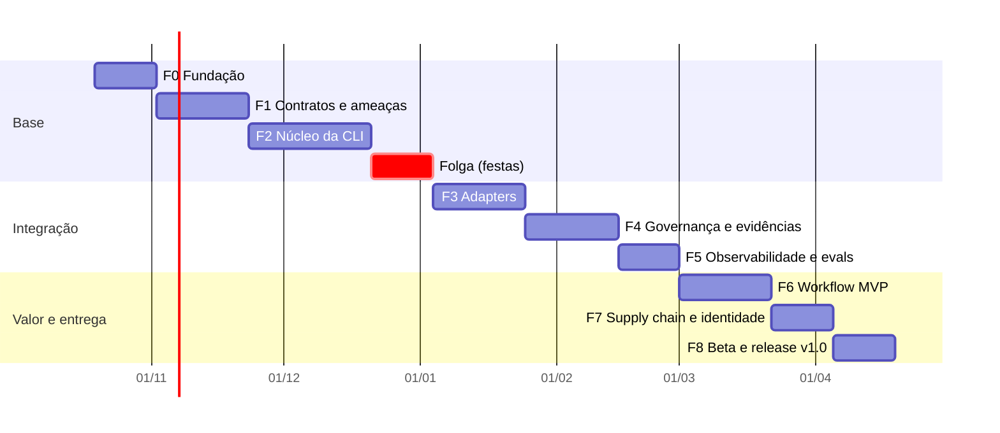

# Roadmap até a v1.0

> Status: Aceito (revisável a cada fase) · Atualizado: 2026-10-24 · Relacionados: [contexto](contexto.md), [ADRs](adr/README.md)

## Premissas

- **Capacidade:** 1 pessoa + agentes de IA. **Horizonte:** ~26 semanas (início 19/10/2026, v1.0 alvo em meados de abril/2027), com 2 semanas de folga no fim do ano.
- Decisões-base: [ADR-0001](adr/0001-alvos-iniciais-claude-code-e-copilot.md) a [ADR-0007](adr/0007-suporte-multiplataforma.md).
- Uma fase só termina quando **todos** os critérios de saída estão verificados por evidência (teste, CI, trace), não por declaração ([contexto §7.9](contexto.md#79-evidências-em-vez-de-alegações)).
- Escopo cortável está marcado com *(corte)*: é o primeiro a sair se houver atraso.

## Visão geral

| Marco | Fim de | Significado |
|---|---|---|
| **M1 — Contratos estáveis** | F1 | Schemas v0 e modelo de ameaças revisados |
| **M2 — Alpha interno** | F3 | CLI instala um pacote real nos dois ambientes |
| **M3 — MVP comprovado** | F6 | Workflow com gates rodando, com métricas no Langfuse |
| **M4 — v1.0 distribuída** | F8 | Publicado no npm com provenance, docs e garantias de compatibilidade |

---

## F0 — Fundação (S1–S2)

**Objetivo:** repositório pronto para evoluir com qualidade e segurança desde o primeiro commit.

Entregas:
- Estrutura TS estrita, Node LTS; decisão monorepo vs. pacote único (ADR).
- Ferramental: lint/format, Vitest, cobertura, Conventional Commits, changesets.
- CI (GitHub Actions) em Windows/macOS/Linux ([ADR-0007](adr/0007-suporte-multiplataforma.md)).
- Baseline de segurança: Renovate/Dependabot, CodeQL, secret scanning, `npm audit` no CI, branch protection, `SECURITY.md`.
- Padrão de documentação e agente `doc-writer` ([guia](guias/padrao-de-documentacao.md)).

Critérios de saída: CI verde nos 3 SOs; PR sem testes ou com cobertura abaixo do limite é bloqueado; scanners ativos.

## F1 — Contratos e modelo de ameaças (S3–S5)

**Objetivo:** responder às perguntas em aberto do [contexto §12](contexto.md#12-perguntas-em-aberto) que bloqueiam implementação.

Entregas (em `docs/specs/` e `docs/arquitetura/`):
- Mapa de módulos: núcleo × adapters × validadores × telemetria.
- Specs v0 (JSON Schema): **manifesto de pacote**, **configuração do projeto**, **lockfile**, **policy**, **registro de evidência**, **evento de auditoria**.
- Matriz de capacidades por ambiente (o que Claude Code e Copilot suportam).
- Formato e precedência de policies (núcleo > organização > projeto > pacote) — ADR.
- Modelo de ameaças (STRIDE) cobrindo pacotes maliciosos, path traversal, execução de scripts, vazamento de segredos, prompt injection via pacote.
- Modelo de permissões declaradas por componente.
- Propriedade e isolamento de pacotes ([ADR-0017](adr/0017-propriedade-de-pacotes-por-identidade-github.md)): entrada para o modelo de ameaças e para o manifesto (campos de dono, identidade esperada e permissões comparáveis entre versões).

Critérios de saída: schemas com testes de exemplos válidos/inválidos; cada ameaça alta tem controle planejado em uma fase.

## F2 — Núcleo da CLI (S6–S9)

**Objetivo:** administrar o harness em um projeto existente de forma previsível.

Entregas:
- Comandos: `init`, `add`, `remove`, `update`, `list`, `plan` (diff do que será aplicado), `apply`, `validate`, `doctor`.
- Resolução de pacotes via Git (tags semver → commit SHA), lockfile com hash de conteúdo, verificação de integridade.
- Preservação de customizações locais (overlay ou merge de 3 vias) e detecção de conflito.
- Validação de manifestos e caminhos (bloqueio de path traversal, symlinks, arquivos fora do escopo).
- **Modelo de eventos local**: toda operação gera evento de auditoria (JSONL) com ator, versão e resultado — base para F4/F5.
- `--dry-run` em todas as operações que alteram arquivos.
- Invariantes do [ADR-0018](adr/0018-invariantes-de-seguranca-da-instalacao.md): nenhum código de pacote roda na instalação; recusa de origem fora da lista permitida; diff de instruções no `plan`/`update`.
- Controles F2 do [modelo de ameaças](arquitetura/modelo-de-ameacas.md): Git sem injeção de argumento ou transporte (T3), caracteres invisíveis escapados no `plan` (T5), limites de tamanho e profundidade (D1), redação de segredos na auditoria e no lockfile (I1), MCP e hooks sem download em tempo de execução (E7).

Critérios de saída: testes E2E nos 3 SOs instalando/atualizando/removendo pacote de exemplo; `update` nunca sobrescreve customização sem aviso; fuzzing de manifestos sem falhas; testes previstos das ameaças com fase F2 no [modelo de ameaças](arquitetura/modelo-de-ameacas.md) passando.

## F3 — Adapters Claude Code e Copilot (S12–S14)

**Objetivo:** materializar o mesmo pacote nos dois ambientes ([ADR-0001](adr/0001-alvos-iniciais-claude-code-e-copilot.md)).

Entregas:
- Contrato de adapter + testes de conformidade compartilhados.
- Adapter Claude Code: agents, skills, instructions (CLAUDE.md), MCP, settings/permissões, hooks.
- Adapter Copilot: instructions, prompts, agents, MCP.
- Spike: nível de enforcement possível no Copilot (resolver a hipótese do ADR-0001).
- Pacote "starter" oficial usado como fixture.

Critérios de saída (**M2**): snapshot tests da saída de cada adapter; capacidade não suportada gera aviso explícito; instalação real validada manualmente nos dois ambientes.

## F4 — Governança e evidências (S15–S17)

**Objetivo:** regras verificadas fora do modelo ([contexto §7.1](contexto.md#71-governança-como-parte-da-arquitetura)).

Entregas:
- Motor de policies com precedência e explicação da decisão ("por que bloqueou").
- Enforcement no Claude Code via hooks (ex.: bloquear comando/arquivo, exigir aprovação).
- Enforcement complementar para qualquer ambiente: validadores em pre-commit e CI (`harness validate --ci`).
- Fluxo de aprovação de operações sensíveis com registro de quem aprovou ([ADR-0003](adr/0003-controle-de-usuarios-faseado.md)).
- Registro de evidência que distingue **solicitado / executado / verificado / falhou / ignorado**.
- Trilha de auditoria com encadeamento de hash (detecção de adulteração).

Critérios de saída: suíte de testes de policies (casos permitidos/negados); nenhum gate ignorado aparece como aprovado; adulteração do log detectada por `doctor`.

## F5 — Observabilidade e evals (S18–S19)

**Objetivo:** quantificar resultados ([ADR-0004](adr/0004-observabilidade-langfuse-opcional.md)).

Entregas:
- Exportador OpenTelemetry → Langfuse (opt-in); traces por workflow/etapa/ferramenta, com custo, tokens e latência.
- Redação de segredos/PII antes da exportação, com testes.
- Docker Compose de referência do Langfuse + runbook.
- Datasets e evals: verificações determinísticas + LLM-as-judge com rubricas versionadas.
- Dashboards/consultas para as [métricas de sucesso](#métricas-de-sucesso), cobrindo as [visões do painel do pipeline](specs/pipeline-agentico.md#painel).

Critérios de saída: trace completo de uma execução visível no Langfuse local; teste garante que segredos de fixture nunca chegam ao exportador; telemetria desligada = zero chamadas de rede.

## F6 — Workflow MVP: feature com gates (S20–S22)

**Objetivo:** provar valor real ponta a ponta ([ADR-0006](adr/0006-workflow-mvp-feature-com-gates.md)).

Entregas:
- Workflow `spec → plano → implementação → testes → review` como pacote oficial, conforme a [spec do pipeline](specs/pipeline-agentico.md) ([ADR-0011](adr/0011-pipeline-agentico-com-laco-de-revisao-humana.md)).
- Spec da etapa E0 (base de conhecimento do projeto) já na [spec do pipeline](specs/pipeline-agentico.md#e0-base-do-projeto); o agente vem em ficha seguinte, fase `Em aberto`.
- Gates por etapa: spec com critérios de aceite; plano revisado; testes passando + cobertura; review com checklist de policies.
- Aprovação humana configurável entre etapas.
- **Benchmark interno:** conjunto de 10–20 tarefas reais (golden tasks) executadas com e sem harness para comparação.

Critérios de saída (**M3**): benchmark executado nos dois ambientes com resultados no Langfuse; relatório comparativo de qualidade, custo e conformidade.

## F7 — Supply chain e identidade (S23–S24)

**Objetivo:** confiar no que se instala e saber quem fez o quê.

Entregas:
- Assinatura e verificação de pacotes (Sigstore) e níveis de confiança (oficial, verificado, comunidade, local).
- Identidade do dono gravada no lockfile e troca de dono bloqueada até aprovação ([ADR-0017](adr/0017-propriedade-de-pacotes-por-identidade-github.md)).
- Permissões declaradas exibidas e aprovadas na instalação; execução de scripts de terceiros desabilitada por padrão.
- Identidade via Git e papéis em arquivo versionado ([ADR-0003](adr/0003-controle-de-usuarios-faseado.md)).
- SBOM e provenance (SLSA) do próprio harness.
- *(corte)* Sandbox de execução para scripts de pacotes.
- Rever a lista de origens permitidas diante da assinatura e dos níveis de confiança ([ADR-0018](adr/0018-invariantes-de-seguranca-da-instalacao.md)).

Critérios de saída: pacote não assinado/adulterado é rejeitado conforme política; testes cobrindo as ameaças altas do modelo da F1.

## F8 — Beta e release v1.0 (S25–S26)

**Objetivo:** distribuir com garantias.

Entregas:
- Decisões de **licença** e **nome** (ADRs) — bloqueiam o release.
- Beta fechado com 3–5 projetos reais; correções.
- Política de compatibilidade e versionamento (semver dos schemas e da CLI), guia de migração.
- Docs de usuário: quickstart, criação de pacotes, contribuição, segurança.
- Pipeline de release: npm com provenance e publicação por OIDC (trusted publishing, sem token guardado; ameaça E6), changelog automático, binários *(corte)*.

Critérios de saída (**M4**): instalação limpa via `npx` nos 3 SOs; zero vulnerabilidades altas abertas; checklist de release com evidências anexadas.

---

## Transversais (todas as fases)

### Estratégia de qualidade

| Camada | O que cobre | Ferramenta |
|---|---|---|
| Unitário | Núcleo, resolução, policies | Vitest |
| Contrato | Schemas e contrato de adapter | JSON Schema + fixtures |
| Snapshot | Saída gerada por adapter | Vitest snapshots |
| E2E | CLI em diretórios temporários, 3 SOs | CI matrix |
| Segurança | Fuzzing de manifestos, path traversal, redação | Testes dedicados + CodeQL |
| Evals | Qualidade das saídas de agentes/workflows | Langfuse datasets |

Meta inicial de cobertura do núcleo: ≥ 80% de linhas, 100% em policies e verificação de integridade.

### Execução por agentes
Cada entrega passa pelo [time de agentes](guias/time-de-agentes.md) e seus gates ([ADR-0009](adr/0009-time-de-agentes-para-executar-o-roadmap.md)); a escolha de agentes por fase está no [guia §3](guias/time-de-agentes.md#3-escolha-por-fase).

### Documentação
Cada fase entrega seus ADRs/specs via agente `doc-writer`; o [contexto](contexto.md) é atualizado quando princípios ou escopo mudam.

## Métricas de sucesso

| Dimensão | Métrica | Fonte |
|---|---|---|
| Qualidade | Taxa de gates aprovados na 1ª tentativa; score de evals; retrabalho (iterações por etapa); defeitos encontrados após o review | Evidências + Langfuse |
| Custo/eficiência | Tokens e custo por workflow/etapa; latência; nº de iterações | Langfuse |
| Conformidade | Violações bloqueadas; aprovações humanas; % de etapas com validador; gates ignorados (deve ser 0 reportado como aprovado) | Auditoria local |
| Adoção | Pacotes instalados/atualizados; uso por componente (local, opt-in) | Eventos locais |

As metas numéricas são definidas após a primeira linha de base no benchmark da F6.

## Riscos

| Risco | Impacto | Mitigação |
|---|---|---|
| Escopo grande para 1 pessoa em 6 meses | Atraso da v1.0 | Itens *(corte)*; folga de 2 semanas; reduzir workflow MVP (ADR-0006) |
| Copilot com enforcement limitado | Governança desigual | Validadores externos (pre-commit/CI); matriz de capacidades transparente |
| Mudanças frequentes nas APIs dos ambientes | Retrabalho nos adapters | Testes de conformidade; adapters isolados do núcleo |
| Supply chain npm | Comprometimento do harness | Baseline F0, provenance, SBOM, dependências mínimas |
| Vazamento de dados via telemetria | Perda de confiança | Opt-in, redação testada, self-hosted |
| Nome colidindo com marca existente | Retrabalho na distribuição | Decisão de naming antes da F8 |

## Pós-v1.0 (condicionado a evidências)

- Servidor opcional: contas, organizações, RBAC, SSO ([ADR-0003](adr/0003-controle-de-usuarios-faseado.md)).
- Registry/catálogo de pacotes com revisão comunitária ([ADR-0005](adr/0005-distribuicao-git-lockfile.md)).
- Novos adapters (Cursor, outros).
- Orquestração/runtime próprio de workflows ([contexto §5](contexto.md#5-direção-conceitual)).
- Interface web e dashboards de governança cross-repo.
