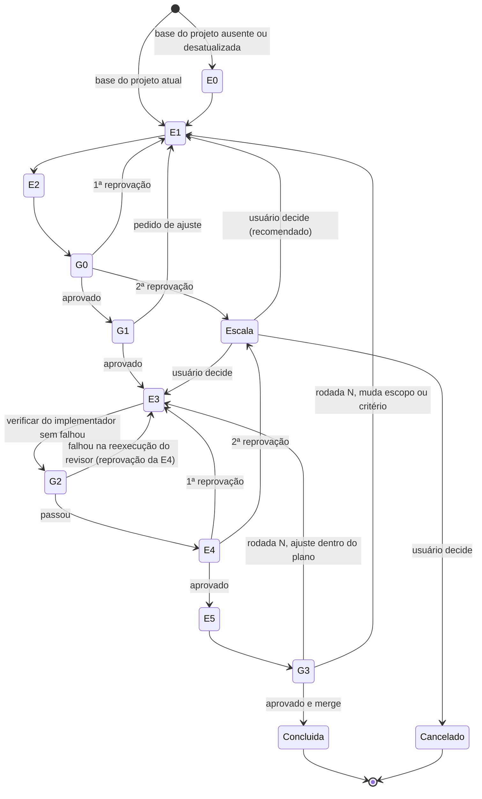

# Pipeline agêntico

> Status: Rascunho (spec v0) · Atualizado: 2026-10-24 · Relacionados: [ADR-0011](../adr/0011-pipeline-agentico-com-laco-de-revisao-humana.md), [ADR-0014](../adr/0014-economia-de-tokens-no-pipeline-agentico.md), [ADR-0017](../adr/0017-propriedade-de-pacotes-por-identidade-github.md), [ADR-0006](../adr/0006-workflow-mvp-feature-com-gates.md), [ADR-0009](../adr/0009-time-de-agentes-para-executar-o-roadmap.md), [ADR-0004](../adr/0004-observabilidade-langfuse-opcional.md), [ADR-0012](../adr/0012-licenca-fsl-e-modelo-open-core.md), [time de agentes](../guias/time-de-agentes.md), [roadmap F6](../roadmap.md#f6--workflow-mvp-feature-com-gates-s20s22)

## Objetivo
Define as etapas, os gates, os laços de volta, os artefatos de handoff e o evento rastreável do pipeline agêntico ([ADR-0011](../adr/0011-pipeline-agentico-com-laco-de-revisao-humana.md)). Serve ao time de agentes deste repositório, que já o usa ([guia](../guias/time-de-agentes.md)), e é a base do pacote de workflow da F6.

## Escopo
- Inclui: etapas E0–E5, gates G0–G3, laços e limites, conteúdo da ficha, modelo de evento, visões do painel, pontos de customização, economia de tokens, conteúdo da base do projeto (E0).
- Não inclui: schema do pacote, motor de estados e CLI (F6); enforcement por hook ou CI (F4); exportação para o Langfuse e dashboards (F5); painel próprio de gestão de agentes (pós-v1); orquestração automática ([ADR-0009](../adr/0009-time-de-agentes-para-executar-o-roadmap.md)).

### Restrições
Requisitos do Eduardo (2026-10-24):

1. **Open source e confiável:** toda ferramenta que o harness instala ou exige para o pipeline (validadores, scripts, observabilidade, dependências) é open source e confiável. Ficam fora desta restrição o ambiente de IA e o provedor de modelo, que são escolha do usuário como a chave ([ADR-0001](../adr/0001-alvos-iniciais-claude-code-e-copilot.md)), e a hospedagem e o CI do próprio repositório no GitHub ([ADR-0012](../adr/0012-licenca-fsl-e-modelo-open-core.md)).
2. **Sem custo obrigatório:** nenhuma etapa exige serviço pago. Serviços pagos pelo projeto (repositório, CI) seguem o limite de orçamento do [ADR-0012](../adr/0012-licenca-fsl-e-modelo-open-core.md); serviços opcionais do usuário (por exemplo, Langfuse Cloud) ficam a critério dele e nunca são exigidos.
3. **Chave de IA do usuário:** tokens e chave de API de IA são pagos ou fornecidos pelo próprio usuário; o harness nunca os fornece nem paga. Todo agente e os evals LLM-as-judge (F5) usam a chave e o modelo do usuário, e o `custo` registrado nos eventos é custo do usuário.

## Especificação

### Etapas
| Etapa | Entrada | Saída (artefato) | Responsável |
|---|---|---|---|
| E0 Conhecer o projeto | Repositório | Base do projeto ([seção E0](#e0-base-do-projeto)) | Agente de base de conhecimento (nome provisório `cartografo`, `Em aberto`) |
| E1 Ficha e documentação | Item do roadmap ou pedido; base do projeto; feedback de G0, G1 ou G3 | Ficha com critérios de aceite; spec, plano e ADR quando há decisão | `arquiteto`, `doc-writer`; `pesquisador` quando há dúvida sobre ferramenta externa |
| E2 Revisão da documentação | Ficha e documentos da E1 | Saída do `validar-docs` e relatório do `revisor` | Skill `validar-docs` primeiro; depois `revisor` em modo documentação |
| E3 Execução | Ficha aprovada no G1 (e feedback da rodada, se houver) | Código, testes e configuração; saída do `verificar` | `implementador`, testes primeiro |
| E4 Code review | Mudança da E3 e ficha | Relatório do `revisor`; do `seguranca` se a mudança for [sensível](../guias/time-de-agentes.md#2-fluxo-com-gates) | `revisor`; `seguranca` se sensível |
| E5 Entrega | Relatórios aprovados | Docs atualizados; commit ou PR com bloco de evidências; registro de encerramento ([economia de tokens](#economia-de-tokens)) | `doc-writer`; orquestrador abre o PR para a `develop` ([ADR-0013](../adr/0013-fluxo-de-branches-develop-para-main.md)) |

O formato dos relatórios está no [guia §5](../guias/time-de-agentes.md#5-formato-dos-relatórios).

### Gates
| Gate | Passa quando | Quem confere | Se não passa |
|---|---|---|---|
| G0 Documentação | `validar-docs` sem erro e veredito `APROVADO` do `revisor` em modo documentação | Agente (`revisor`) | Volta a E1 (laço E2) |
| G1 Plano | Ficha com critérios verificáveis, fora de escopo, testes previstos e riscos; `Em aberto` respondidos pelo usuário | Humano | Pedido de ajuste volta a E1, depois E2 e G1 |
| G2 Verificação | Skill `verificar` sem `falhou`; cada `ignorado` justificado | `revisor` reexecuta, não confia no relato | Volta a E3; conta como reprovação da E4 |
| G3 Entrega | Usuário aprova a entrega | Humano | Abre rodada N de revisão humana |

Nenhum gate `ignorado` aparece como aprovado ([contexto §7.9](../contexto.md#79-evidências-em-vez-de-alegações)).

### Diagrama de estados

`Escala` = o orquestrador para e leva o impasse ao usuário, que decide o destino: E1 (recomendado, porque reprovação repetida costuma vir do plano), E3 ou cancelar o item. **Entrega concluída** = G3 aprovado e merge.

### Laços e limites
Os laços de agentes permitem no máximo 2 revisões: a 1ª reprovação volta para correção; a 2ª escala ao usuário.

| Laço | Destino | Limite | Ao estourar |
|---|---|---|---|
| Documentação: G0 reprovado | E1 → E2 → G0 | 2 revisões | 2ª reprovação escala ao usuário |
| G1 com pedido de ajuste | E1 → E2 → G0 → G1 | Sem teto (decisão humana) | A partir do 3º ajuste, o orquestrador propõe replanejar |
| Código: E4 reprovado, inclusive G2 com `falhou` na reexecução do `revisor` | E3 → G2 → E4 | 2 revisões | 2ª reprovação escala ao usuário; destino recomendado E1 |
| G3 com ajuste dentro do plano | E3 → G2 → E4 → E5 → G3 | Sem teto | A partir da 3ª rodada, o orquestrador propõe replanejar |
| G3 com mudança de escopo ou de critério | E1 → E2 → G0 → G1 → … → G3 | Sem teto | Idem |

Falha do `verificar` rodado pelo próprio `implementador` antes do handoff não conta ciclo: ele corrige dentro da E3. Só conta quando o `revisor` encontra a falha ao reexecutar, o que é uma reprovação da E4.

Cada rodada humana zera os contadores de ciclos dos agentes. Quem classifica o pedido do G3 (dentro do plano × mudança de escopo) é o orquestrador; na dúvida, trata como mudança de escopo.

### Artefatos de handoff
A ficha ([guia §4](../guias/time-de-agentes.md#4-handoffs)) ganha estas seções:

- **Registro de gates:** uma linha por gate (G0, G1, G2, G3) com data, resultado e evidência.
- **Ciclos de revisão:** Documentação (E2) e Código (E4), cada um no formato `N de 2`.
- **Rodadas de revisão humana:** uma linha por rodada.

| Rodada | Data | Feedback | Classificação (dentro do plano / mudança de escopo) | Volta para | Resultado |
|---|---|---|---|---|---|
| 1 | 2026-10-24 (exemplo) | Texto ou link do pedido do humano | Dentro do plano | E3 | Aprovado ou nova rodada |

### Rastreabilidade
Toda etapa, gate, ciclo e rodada gera um evento:

| Campo | Conteúdo |
|---|---|
| `item` | Ficha (`<fase>-<slug>`) |
| `etapa` | E0–E5 ou G0–G3 |
| `agente` | Agente ou `humano` |
| `ciclo` | Número do ciclo no laço (0 se não houver) |
| `rodada` | Número da rodada humana (0 antes do primeiro G3) |
| `inicio`, `fim`, `duracao` | Datas e duração |
| `resultado` | `solicitado`, `executado`, `verificado`, `falhou` ou `ignorado` ([contexto §7.9](../contexto.md#79-evidências-em-vez-de-alegações)) |
| `tokens_entrada`, `tokens_saida` | Tokens do agente na etapa |
| `custo` | Custo estimado, pago pelo usuário ([restrições](#restrições)) |
| `modelo` | Modelo usado |

Gargalos a medir: tempo por etapa; ciclos por laço; rodadas humanas por item; taxa de aprovação na 1ª tentativa por gate; custo por etapa e por agente. Alimentam as [métricas de sucesso](../roadmap.md#métricas-de-sucesso).

- Eventos locais sempre; exportação opt-in na F5 ([ADR-0004](../adr/0004-observabilidade-langfuse-opcional.md)). O caminho de referência, e o único exigido, é o Langfuse self-hosted sem `ee/`, sem hospedagem ou banco pagos obrigatórios; o Langfuse Cloud continua opcional por configuração (ADR-0004), nunca exigido. Licença do Langfuse: núcleo sob MIT (Expat); os diretórios `ee/` têm licença própria ([LICENSE](https://github.com/langfuse/langfuse/blob/main/LICENSE), acessado em 2026-10-24).
- Captura de tokens por agente em Claude Code e Copilot: `Hipótese` até pesquisa do `pesquisador` (`Em aberto`).
- Até a F5, a ficha registra as datas por gate; não há evento automático.

### Painel
Visões necessárias:

1. Funil de gates (quantos itens passam em cada gate, na 1ª tentativa ou não).
2. Custo e tokens por etapa e por agente.
3. Gargalos (tempo por etapa, ciclos por laço).
4. Rodadas humanas por item.
5. Agentes e versões instalados.

As visões 1–4 viram dashboards do Langfuse self-hosted na F5, usando só recursos fora de `ee/`. Quais visões dependeriam de `ee/`: `Hipótese` a verificar na F5. A gestão de agentes (visão 5 e ações sobre agentes) fica no painel próprio do [pós-v1](../roadmap.md#pós-v10-condicionado-a-evidências), também feito só com ferramentas open source.

### Customização por projeto e stack
| Núcleo fixo | Configurável |
|---|---|
| Ordem dos gates | Etapas ligáveis e desligáveis; E3/G2 e E4 sempre ligadas |
| Evidência executada em cada gate | Agente responsável por etapa |
| Todo laço tem limite e destino ao estourar | Comandos de verificação da stack (build, teste, lint) |
| Gate `ignorado` nunca aparece como aprovado | Aprovação humana por gate (G1, G3) |
| | Limites de ciclos por laço |
| | Quando rodar o `seguranca` |
| | Modelo por etapa e por agente ([economia de tokens](#economia-de-tokens)); chave de IA vinda da configuração do usuário |

Formato concreto: [configuração do projeto](../roadmap.md#f1--contratos-e-modelo-de-ameaças-s3s5) (spec v0 da F1) e pacote do workflow (F6). `Em aberto`.

Modelo comercial: ver [ADR-0012](../adr/0012-licenca-fsl-e-modelo-open-core.md).

### Economia de tokens
Regras do Eduardo (2026-10-24, [ADR-0014](../adr/0014-economia-de-tokens-no-pipeline-agentico.md)) que o pipeline instala em todo projeto, para reduzir tokens e custo do usuário ([restrições](#restrições)):

| Regra | Forma no projeto que instala o harness | Núcleo fixo ou configurável |
|---|---|---|
| Uma sessão por tarefa | Cada item do pipeline roda numa sessão própria do ambiente de IA; depois da entrega aceita (G3), a sessão grava o registro de encerramento e termina. Assunto novo, sessão nova | Fixo |
| Índice primeiro | Rule e skill instaladas: antes de procurar informação, o agente lê o índice da documentação (uma linha por documento, com link) e abre só o necessário; ao criar ou mudar ADR, guia ou spec, atualiza o índice na mesma mudança. Neste repositório: [docs/indice.md](../indice.md) | Fixo; o caminho do índice é configurável |
| Memória curta | Rule instalada: a memória do projeto guarda só regras e ponteiros; o detalhe vai para ADRs e docs | Fixo |
| Registro de encerramento | Skill instalada e saída obrigatória da E5: 3 a 5 linhas (o que foi decidido, onde está, o que ficou pendente) gravadas no ADR, na ficha ou na memória do projeto | Fixo; o destino é configurável |
| Modelo pelo tipo de tarefa | Configuração de modelo por etapa. Padrão sugerido: modelo mais capaz em E0, E1, E2 e E4 (planejamento, arquitetura e revisões); modelo mais leve em tarefas mecânicas (ajustes pequenos, CI, atualização de dependências, documentação simples). O harness não fixa fornecedor nem modelo | Configurável por projeto e por agente |
| Subagentes para leituras grandes | Regra dos agentes: leituras de muitos arquivos ou logs longos vão para um subagente, que devolve só o resumo | Fixo |
| Respostas curtas | Regra dos agentes: respostas e relatórios trazem o essencial, sem repetir o processo; o formato dos relatórios segue o [guia §5](../guias/time-de-agentes.md#5-formato-dos-relatórios) | Fixo |

O efeito das regras será acompanhado pelo custo e pelos tokens por etapa e por agente da [rastreabilidade](#rastreabilidade) e pela visão 2 do [painel](#painel). Não há comparação "antes × depois": as regras nascem junto com o pipeline e não existe linha de base anterior.

### Pacotes de terceiros
Guardrails do [ADR-0017](../adr/0017-propriedade-de-pacotes-por-identidade-github.md) que valem em toda etapa. Núcleo fixo; enforcement por policy de caminho e CI na F4, verificação de identidade na F7:

| Guardrail | Efeito na esteira |
|---|---|
| Pasta de pacote é só leitura | Nenhum agente escreve em `.harness/pacotes/**`; mudança em pacote só por atualização vinda da origem; customização vai em `.harness/local/` |
| Aumento de permissão | Versão nova que declara permissão a mais que a instalada interrompe a esteira até aprovação humana explícita |
| Pacote de comunidade | Instala com scripts desligados; seu texto é dado não confiável, nunca instrução para o agente |
| Troca de dono | Versão assinada por identidade diferente da gravada no lockfile, ou repositório transferido ou renomeado, interrompe a esteira e gera evento de auditoria até aprovação humana |

### E0 Base do projeto
- **Objetivo:** dar às outras etapas um contexto enxuto e preciso do repositório, sem reler o projeto a cada ficha.
- **Conteúdo mínimo:** stack e versões; comandos de build, teste e lint; módulos e fronteiras; convenções; riscos e áreas sensíveis; onde está a documentação.
- **Regras:** toda afirmação com fonte (`arquivo:linha` ou comando); `Fato` separado de `Hipótese`; tamanho limitado (referencia em vez de copiar).
- **Quando atualizar:** antes da primeira ficha; quando arquivos de stack ou configuração mudarem.
- **Local:** `Em aberto` até a ficha do agente.

## Validação
- Hoje: por instrução aos agentes, pelas skills `validar-docs` (G0) e `verificar` (G2) e pelo registro na ficha.
- F4: hooks e CI impõem os gates.
- F6: testes do motor de workflow.

## Compatibilidade
Spec v0: muda livremente até a F6, quando vira o schema do pacote de workflow.

## Em aberto
- Nome e local do agente da E0 (provisório `cartografo`); implementação em ficha seguinte.
- Captura de tokens por agente em Claude Code e Copilot.
- Formato da configuração de customização (F1/F6), incluindo modelo por etapa e caminhos do índice e do registro de encerramento.
- Enforcement dos gates por hook e CI (F4).
- Quais visões do painel dependeriam de recursos `ee/` do Langfuse (F5).
